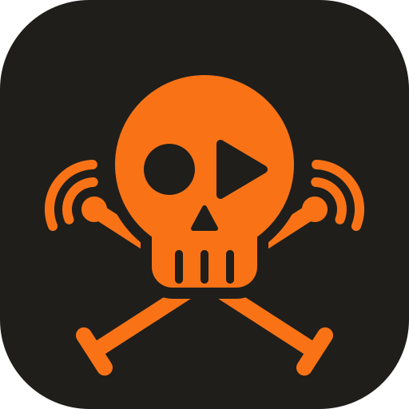

<p align="center"></p>

# Pirate Radio

Your own internet radio for the home lab. It plays a normal radio station (or
your own music from [Navidrome](https://www.navidrome.org)) and **cuts in
automatically** whenever a video channel you follow uploads a new video (as
audio, through your own [Invidious](https://invidious.io) instance) or a
podcast publishes a new episode. Hourly news, jingles and your own ads cut in
on a timer. Other stations can take over during scheduled time windows, like a
morning show. Run **several channels**, e.g. one per family member, each with
its own stream. Everything is set up in a small web UI and stored in one YAML
file.

```
 radio station / Navidrome ─┐
 scheduled show            ─┤                        ┌─► /radio.mp3  (channel 1)
 Video uploads           ─┼─► Liquidsoap ─► Icecast ┼─► /anna.mp3   (channel 2)
 podcast episodes          ─┤   (one mix per          └─► /…aac, /…opus ─► VLC, Home Assistant,
 news, jingles, own ads    ─┘    channel)                                   phones, speakers…
                                    ▲
                                    │
                               controller  ◄── web UI :8080
          (polls Invidious + RSS, fetches from Navidrome, downloads audio, schedules)
```

## How it behaves

- **The station plays** whenever nothing else is on.
- **New clips interrupt right away** with a short fade, and the radio fades back in afterwards.
- **Several new clips** play one after another, oldest first.
- **Programs can follow the stream title** instead of the clock, for shows without a fixed length (see below).
- **Scheduled programs vs. clips: first come, first served.** A clip that is already playing finishes before a program starts; a clip that arrives during a program waits until the program's window ends. If both happen in the same second, one is picked at random.
- **Only new items count.** When you add a channel or feed, everything already there is ignored. Use **Play latest** to hear the newest item right away.
- **Filters per source:** minimum/maximum length (very short videos are skipped by default) and include/exclude words for titles.
- **Spots** (news, jingles, ads) go before waiting clips and also play during programs, but never cut off a clip that is playing.
- **Now playing:** shown in the web UI and sent to players as stream titles. It costs almost nothing, since Liquidsoap already tracks it.

## Quick start

You need Docker with Compose and a running Invidious instance.

```sh
git clone https://github.com/maxASE/rRadio.git
cd rRadio
cp .env.example .env
nano .env          # set the two Icecast passwords and INVIDIOUS_URL
docker compose up -d
```

Open `http://<server>:8080`, add a radio station, video channels and podcasts
under **Sources**, and listen at `http://<server>:8000/radio.mp3` (open a channel
on **Home** for the links plus `.m3u`/`.pls` files).

The web UI has four parts:

- **Home:** a card per channel with what is on, the next six hours and a Listen button.
  Open a channel to see *why* it plays what it plays (cut-in, program or station),
  switch its station, cut in a link, and see the queue and today's rundown.
- **Schedule:** the week as a timeline per channel, with its programs and spots.
- **Sources:** stations, Navidrome playlists, video channels, podcasts and your
  own media in one list, with a checkbox per channel.
- **Settings:** Invidious, Navidrome, stream formats and the rest.

### Pointing at your Invidious

`INVIDIOUS_URL` is how the controller container reaches Invidious:

| Invidious runs… | `INVIDIOUS_URL` |
|---|---|
| on the same host, port published | `http://host.docker.internal:3000` |
| on another machine | `http://192.168.1.20:3000` |
| in another Compose project | join its network (see below) and use `http://invidious:3000` |

To join another project's network, add this to `docker-compose.yml`:

```yaml
services:
  controller:
    networks: [default, invidious]
networks:
  invidious:
    external: true
    name: invidious_default   # check with: docker network ls
```

Audio is fetched through Invidious (`/latest_version?itag=140&local=true`), so
The video site never sees your home IP unless you enable the optional **yt-dlp fallback**
in Settings. Audio is downloaded in 4 MB pieces, because video
throttles one-piece downloads, and the queue shows the progress.
**Settings → video audio quality** picks *Small* (Opus ~70 kbps, the default,
about half the data) or *Standard* (AAC 128 kbps, better for music). Use **Settings → Test** to check the connection.

## Channels

Each channel is a radio of its own: its own stream, stations, programs and
spots, e.g. one per family member. Add them with **+ New channel** on Home;
rename or remove one under **Channel settings** on its page. A channel named "Anna" streams
at `/anna.mp3` (change the stream name if you like). The first channel keeps
`/radio.mp3`, so existing links keep working.

Video channels and podcasts are shared: by default every channel cuts them
in. Untick a channel's checkbox on a source under **Sources** to leave it out
there. Stations work the same way: tick a station for every channel that
should be able to play it. A video that several channels follow is downloaded only once.

Adding, renaming or removing a channel restarts the audio engine, so every
stream drops for a few seconds. Icecast needs one mount per channel and
format; `ICECAST_MAX_SOURCES` (default 20) is the limit.

## Navidrome: your own music

A station or program can play music from Navidrome (or any Subsonic server)
instead of a radio stream: a playlist in order or shuffled, or random songs
from the whole library. Good for a channel of its own, or an evening program.

1. Enter the URL and user under **Settings → Navidrome** and press **Test**.
   For the password, either type it there (it is stored in `config.yaml`) or
   put `NAVIDROME_PASSWORD=` in `.env`, which keeps it out of the config file.
   Navidrome on the same host is usually `http://host.docker.internal:4533`.
2. Under **Sources › + Add source**, choose **Navidrome** and pick a playlist.
   For a program, choose **Navidrome** in **Schedule › + Program**.

Songs are fetched one ahead as MP3 (192 kbps by default, changeable in
Settings) and deleted after they played. Cut-ins pause the song and it
continues afterwards. **Next song** on the channel's page skips ahead.

## Shows without a fixed length: programs started by the stream title

Many stations send the name of the show as the stream title (ICY metadata),
for example `Jetzt: Hafenradio Live vom 21.10.2026 - …` during a morning show. A
program can follow that instead of its clock times: set **When** to *Only
while the stream title says the show is on* and fill in

- **Show is on when the title matches:** a pattern for the show's title,
  e.g. `Jetzt: Hafenradio Live`. Make it specific enough to skip promos such as
  `Um 18:00 Hafenradio Live am Abend einschalten!`.
- **…and stays on for titles like:** titles that interrupt the show without
  ending it, e.g. `Nachrichten|Werbung`.
- **Ends at once when the title matches** (optional): an explicit end title.
- **Ends after N minutes of other titles:** how long other titles (songs)
  may run before the show counts as over. A short news break in between
  that matches neither pattern also needs less than this.
- **Stream to watch:** empty means the program's own stream. Set it to play
  something else (say a Navidrome playlist) while another station's show runs.

The time window stays the outer limit: titles are only read while it is open
(one extra connection to the station, audio discarded) and the program always
ends with it. Patterns are regular expressions and ignore case. **Check title
now** shows the current title and which pattern it matches, and *Titles seen
in the window* lists every title with its time, which helps to tune the
patterns after the first show. In YAML:

```yaml
    programs:
      - name: Hafenradio Live am Morgen
        url: https://example.com/hafenradio.mp3
        days: [mon, tue, wed, thu, fri]
        start: "05:55"
        end: "11:00"
        trigger: title              # time (default) | title
        title_start: "Jetzt: Hafenradio Live"
        title_keep: "Nachrichten|Werbung"
        title_end: ""
        end_after_minutes: 3
        title_url: ""               # empty = the program's url
        cutins_interrupt: false     # true = new uploads and episodes may play during it
```

New video uploads and podcast episodes wait while a program is on and play
when it ends. Tick *Let new video uploads and podcast episodes interrupt this
program* under **Schedule › Edit** to let them through. The log says why each
program ended (`Program … ended on … (window over | title: … | ended by hand)`)
and when a clip cut in (`Cut-in on …: … (during program …)`).

## Spots: news, jingles and your own ads

Under **Schedule › + Spot**, each channel can cut in things on a timer:

- **What:** your own files (one file, several, or a whole folder; in turn or
  at random), or **the newest episode of a feed**. Many broadcasters publish
  short news bulletins as podcast feeds (for example *Tagesschau in 100
  Sekunden* or *Deutschlandfunk Nachrichten*); paste the feed URL from their
  podcast page. *Skip if there is no new episode* avoids hearing the same
  bulletin twice.
- **When:** every N minutes counted from midnight (60 at :00 = on the hour,
  30 at :15 = :15 and :45), at fixed times, or after every N songs on the
  station. Each spot can be limited to days and a time window.
- **Wait for the end of the current song** holds the spot until the station's
  song title changes (at most 10 minutes), so ads land between songs. With a
  radio station this relies on the station sending song titles.
- **Play now** plays a spot right away.

Spots go before other waiting clips and, unless you untick it, also play
during scheduled programs.

### Own media and the drop folder

Upload files under **Sources › + Add source › Own media** (optionally into folders like `ads` or
`jingles`); all channels share them. **Play now** cuts one in on the current
channel.

Anything copied into the `inbox/` folder plays once on the first channel and
then moves to `played/`. `inbox/<stream name>/` targets a channel, e.g.
`inbox/anna/`. Handy for Home Assistant: write a TTS file there and it is
announced.

Files live in the `radio-data` volume by default. To use a folder on the
server instead (so you can drop files in over SMB or `scp`), copy
[`docker-compose.override.example.yml`](docker-compose.override.example.yml)
to `docker-compose.override.yml`, then:

```sh
mkdir -p media && sudo chown -R 10000 media   # the controller runs as uid 10000
docker compose up -d
```

## Pictures for what is playing

Home and each channel's page show a picture next to the title:

- **Video**: the channel's profile picture (the video thumbnail if there is
  none), loaded through your Invidious.
- **Podcasts**: the episode's cover, or the podcast's.
- **Navidrome**: the song's album cover.
- **Radio stations**: streams send a title but no picture, so set a logo
  under **Sources → Edit**: paste a URL or upload a file. **Find logo** (and
  adding a new station) looks the stream up on
  [radio-browser.info](https://www.radio-browser.info), then on the station's
  own website. A program without its own logo uses the one of a station with
  the same stream.
- **Spots and news**: a feed's cover, or a picture you set on the spot.

Uploaded pictures are kept in `/data/images`.

On **Schedule**, hover over (or tap) a spot or program for its details: what
plays, the rule, the newest episode of a news feed and whether it was played
already, and when it plays next.

The controller fetches and caches the pictures, so browsers only talk to rRadio.

`http://<server>:<port>/api/art/now/<channel>.jpg` (channel id or mount) always
serves the picture of what is playing right now, or the rRadio logo. It needs
no password, so you can give it to apps that show a station picture by URL.
Many apps cache such pictures, so it may not change there live.

## Stream formats

Pick them in **Settings → Stream formats**. You can run several at once.

| Format | Mount | Good for |
|---|---|---|
| MP3 128 kbps (default) | `/radio.mp3` | Plays everywhere: VLC, browsers, Home Assistant, Sonos, car apps |
| AAC (HE-AAC) 96 kbps | `/radio.aac` | Same quality at less data; nice for phones over Tailscale |
| Opus 96 kbps | `/radio.opus` | Best quality per bit; some speakers and cars can't play it |

Other channels use their own stream name instead of `radio`, e.g. `/anna.aac`.

`.m3u` and `.pls` are not formats, just tiny playlist files that point a
player at a stream: `http://<server>:8080/listen.m3u?fmt=aac`. Add
`&channel=anna` (the stream name) for another channel; the On air page shows the right links.

## nginx, Pi-hole and Tailscale

- **nginx:** [`examples/nginx.conf`](examples/nginx.conf) serves the UI and the
  streams on one hostname. Then set `PUBLIC_STREAM_BASE=https://radio.home.lan`
  in `.env` so the links and playlists use that hostname.
- **Pi-hole:** add a *Local DNS record* `radio.home.lan → <server IP>`.
- **Tailscale:** open `http://<server-tailnet-name>:8080`. With `PUBLIC_STREAM_BASE`
  left empty, the stream links follow whatever hostname you opened the UI with,
  so the same setup works on the LAN and on your tailnet. Alternatively run
  `tailscale serve` in front of nginx for HTTPS.
- **Password:** set `UI_PASSWORD` to protect the web UI. The browser then shows
  a log-in page (user `admin` unless `UI_USERNAME` is set) and stays logged in
  for 30 days; **Log out** is at the top right. After 10 wrong passwords from one
  address, log-in pauses for five minutes. Scripts and dashboards can still send
  the same user and password as HTTP Basic auth. The streams and playlist files
  stay open so players don't need a login.

## HTTPS and remote access

Phones and browsers increasingly insist on HTTPS: browsers only allow the
microphone (voice messages) over HTTPS, and the iOS and Android apps refuse
plain HTTP unless a server is explicitly allowed. Pick one of these:

- **Tailscale (easiest, also gives remote access):** on the server run
  `tailscale serve --bg 8080`. rRadio is then at
  `https://<server>.<tailnet>.ts.net` with a real certificate, reachable only
  from your own devices, at home and on the road. Add the streams with
  `tailscale serve --bg --set-path /radio.mp3 http://127.0.0.1:8000/radio.mp3`
  (one line per stream), or open them via the tailnet name and port 8000.
- **Nginx Proxy Manager with your own domain:** on the proxy host, open the
  *SSL* tab, request a Let's Encrypt certificate (a DNS challenge works for
  hosts that aren't reachable from the internet) and tick *Force SSL*. Then set
  `PUBLIC_STREAM_BASE=https://<your host>` in `.env`.
  For the streams, don't add a custom location per channel (a new channel then
  sits on "Connecting"). Put this in the proxy host's *Advanced* tab instead,
  so every channel's stream goes to Icecast:

  ```nginx
  location ~ ^/[a-z0-9_-]+\.(mp3|aac|opus)$ {
      proxy_pass http://<server IP>:8000;
      proxy_buffering off;
      proxy_read_timeout 24h;
      proxy_http_version 1.1;
  }
  ```
- **Internal name like `rradio.hp`:** Let's Encrypt can't issue for it. Either
  use the Tailscale name above, or create your own certificate (e.g. with
  `mkcert`), upload it in NPM under *SSL Certificates › Custom*, and install
  mkcert's root certificate on your phones.

### Optional: client certificates (mTLS)

With mTLS only devices holding a certificate you issued get through the proxy
at all. rRadio needs no change; it is set up in Nginx Proxy Manager. It is
extra work for every phone and browser, and Tailscale gives similar protection
with less effort, so treat this as optional.

```sh
# a small certificate authority and one client certificate (repeat for each device)
openssl req -x509 -newkey rsa:4096 -nodes -days 3650 -subj "/CN=rRadio clients" -keyout ca.key -out ca.pem
openssl req -newkey rsa:2048 -nodes -subj "/CN=max-phone" -keyout phone.key -out phone.csr
openssl x509 -req -in phone.csr -CA ca.pem -CAkey ca.key -CAcreateserial -days 825 -out phone.pem
openssl pkcs12 -export -inkey phone.key -in phone.pem -certfile ca.pem -out phone.p12   # import this on the phone
```

Copy `ca.pem` into NPM's data folder (e.g. `data/custom_ssl/rradio-ca.pem`) and
add to the proxy host's *Advanced* tab:

```nginx
ssl_client_certificate /data/custom_ssl/rradio-ca.pem;
ssl_verify_client on;
```

Players such as Navidrome, Sonos or car radios can't present a certificate, so
serve the streams from a second proxy host without mTLS (or straight from port
8000) and point `PUBLIC_STREAM_BASE` at it.

## Voice messages

On a channel's page, **Voice message › Record** records from the microphone;
listen to it, give it a title if you like, then play it on that channel or on
all channels. It cuts in like an announcement (also during programs). The
recording is kept on the RAM disk (`radio-ram`, whatever the download setting)
and deleted once it has played everywhere, so it never touches the SSD unless
the RAM disk is missing.

Browsers only allow the microphone over HTTPS or on `localhost`. Over plain
HTTP, use the file field instead: phones offer their voice recorder there.
Apps send the same thing with `POST /api/voice` (form fields `file`,
`channel` = a channel id or `all`, optional `title`).

**What plays underneath.** `/api/status` lists the channel's `stations` (id,
name, kind, playlist, art) and the `current_station`. Apps switch with
`POST /api/station` and `{"id": …}`, or pick a Navidrome playlist with
`{"playlist": "<name>"}` (`""` = random songs from the library; the names come
from `GET /api/navidrome/playlists`). A playlist the channel doesn't have yet
is added to it as a Navidrome station.

**Listen again.** The apps can play a clip from the history again, on the phone
only, with `GET /api/history/<id>/audio` (the `id` and `replay` fields of the
`history` entries in `/api/status`), or put it back on the radio with
`POST /api/history/<id>/play-next`; what is kept (a recorded program, a voice message) can be removed early with `DELETE /api/history/<id>/replay`. Nothing is recorded for this: video
clips, podcast and news episodes and links are fetched again from their source. Voice
messages exist nowhere else, so a copy is kept for 24 hours (in RAM or on disk,
following the download setting); turn this off under **Settings › Keep voice
messages for a day**. Inbox files and the live radio can't be played again,
except programs marked **Keep it for 24 hours** (Schedule › program): those are
recorded from their stream while they run, into the RAM disk when downloads go
there (about 60 MB per hour of MP3, so raise `RAM_CACHE_SIZE` to `1g` or more
for long shows), and the apps can listen back from the program's "started"
entry, even while it is still on air (the recording answers byte ranges, so the
apps can drag back along the show and return to live). Recording stops early if
the RAM disk is nearly full. History entries carry the picture that was shown
while they played (`art`), so the apps can show it again when listening back. If rRadio restarts during a program (an update), the program
goes on: no second "started" entry, and recording continues in the same file
when it is on disk. A RAM disk is emptied with the container, so there the part
before the restart is lost and the apps can scroll back only to the restart.

## Apps and device keys

Apps don't use the UI password. Each phone or tablet gets its own key instead,
which you can limit and remove without touching the others.

1. Open **Settings › Apps and devices**, enter a name, choose what the app may
   do and (optionally) which channels, then press **Show pairing code**.
2. Scan the QR code with the app, or type the 10-letter code. The code works
   once and expires after 10 minutes.
3. The app now appears under **Paired**. Change its role there, or press
   **Remove** to revoke its key at once.

Roles: **Everything** can do anything the web UI can. **Listen and control**
can read the status and, on its channels only, skip, end a program, remove
from the queue, cut in a link, own media, a spot or the latest episode, and
change the station. It can't see or change settings, sources or the schedule.

Device limits only matter when `UI_PASSWORD` is set; without it, anyone on
your network can use the web UI and its API anyway.

For app developers: the QR code holds `rradio://pair?server=<url>&code=<code>`.
The app sends `POST /api/pair` with `{"code": "...", "device_name": "..."}`
(open without the password) and gets back `{"token": "rr_...", "device": {...},
"channels": [...], "streams": {...}}`. It then sends
`Authorization: Bearer <token>` with every request; `GET /api/me` says which
device, role and channels the key has. Keys are stored only as SHA-256 hashes
in `state.db`, so they never end up in `config.yaml` or a backup. A removed or
unknown key gets `401`, a forbidden action `403`.

`GET /api/events?channel=<id>` is a live feed (Server-Sent Events) with the same
JSON as `/api/status`: one `data:` line right away, then a new one only when
something changes (a clip starts, the queue or station changes, a download
progresses). A `: ping` comment comes every 20 seconds while nothing happens,
and the server ends the stream after 30 minutes so the client reconnects. The
web UI uses it too, so an idle open tab costs the server nothing; clip times are
counted up in the browser. Behind nginx, the feed sends `X-Accel-Buffering: no`
so it is not held back; no proxy changes are needed.

## Homepage dashboard widget

[Homepage](https://gethomepage.dev) can show what is on air with its built-in
`customapi` widget; nothing extra to install. rRadio serves a small read-only
summary at `/api/widget`:

```json
{"status": "Cut-in", "on_air": "Tagesschau", "title": "tagesschau 12:00 Uhr",
 "queue": 2, "downloading": 1, "listeners": 3,
 "last_cutin": "Tagesschau: tagesschau 12:00 Uhr", "last_cutin_at": "2026-10-21T12:00:41+02:00",
 "next_program": "Morning show", "next_program_at": "2026-10-22T07:00:00+02:00",
 "station": "Pirate Radio"}
```

`status` is `Radio`, `Cut-in`, `Program`, `Silence` or `Offline`. `queue`
counts clips waiting to play (including ones still downloading). It describes
the first channel; add its stream name for another one, e.g.
`/api/widget?channel=anna`.

Add this to Homepage's `services.yaml`, with `url` pointing at rRadio's web UI
(`http://<server>:8080`, or your nginx hostname):

```yaml
- Media:
    - rRadio:
        icon: http://radio.home.lan/static/logo.svg   # served by rRadio itself
        href: http://radio.home.lan/
        description: Radio with cut-ins
        widget:
          type: customapi
          url: http://radio.home.lan/api/widget
          refreshInterval: 15000
          # username: admin        # only if UI_PASSWORD is set
          # password: your-ui-password
          display: list
          mappings:
            - field: status
              label: On air
            - field: title
              label: Playing
            - field: queue
              label: Queue
              format: number
            - field: listeners
              label: Listeners
              format: number
            - field: last_cutin
              label: Last cut-in
            - field: last_cutin_at
              label: Cut in
              format: relativeDate
            - field: next_program
              label: Next program
```

Drop `display: list` for the compact block view, which fits about four fields.

If `UI_PASSWORD` is set, either fill in `username`/`password` above (Homepage
sends them as Basic auth), or set `WIDGET_PUBLIC=true` in `.env` so only
`/api/widget` is readable without a login. The logo (`/static/logo.svg` and
`/static/apple-touch-icon.png`) is always readable, so the icon shows either way.
Everything else stays protected.

## Configuration file

The web UI writes `config.yaml` in the `radio-data` volume. You can also edit
it by hand; changes are picked up within about 15 seconds.

```sh
docker compose exec controller cat /data/config.yaml
```

See [`config.example.yaml`](config/config.example.yaml) for all options.

Configs from before channels are upgraded automatically on the first start:
the old stations and programs become the first channel, which keeps
`/radio.mp3`.

Other `.env` settings: `TZ`, `STATION_NAME`, `DEFAULT_STATION_URL`,
`NAVIDROME_URL`/`NAVIDROME_USER`/`NAVIDROME_PASSWORD`, `ICECAST_MAX_SOURCES`,
`UI_PORT`, `ICECAST_PORT`, `FADE_SECONDS` (fade length) and `CUTIN_GAIN_DB`
(make cut-ins louder or quieter than the radio).

## Moving channels and backups

- **Export channel** (on a channel's page) downloads a zip with that channel:
  its stations, programs (with title triggers), spots, the video channels
  and podcasts it cuts in from, the own audio its spots play and uploaded
  pictures.
- **Settings › Import** adds it on another rRadio as a new channel, optionally
  under a new name. Name and stream name get a number if they are taken,
  sources that already exist there (same video channel or feed URL) are
  reused, and if any audio file would overwrite a different file of the same
  name, the import's audio goes into a folder named after the channel.
- **Settings › Download full backup** is a zip with the whole config, all own
  audio and pictures. Importing it replaces everything after a confirmation;
  the old config is kept as `config.before-restore-<time>.yaml`.

Neither includes the Navidrome password (set it again under Settings),
history or downloaded clips. Navidrome stations refer to playlists by name.

## Upgrading

```sh
cd rRadio
git stash            # only if you changed tracked files, e.g. ports in docker-compose.yml
git pull
git stash pop
docker compose up -d --build
```

Better: move local edits into `docker-compose.override.yml` (see
[the example](docker-compose.override.example.yml)) so `git pull` never
conflicts.

Releases are tagged (`v1.0.0`, ...). To stay on a release instead of the
newest code, use `git checkout v1.0.0` instead of `git pull`, or the image
`ghcr.io/maxase/pirate-radio-controller:1.0.0`. `GET /healthz` shows the
running `version` and the `api` level apps check.

## Resources

Three small containers. In testing they used about 5 MB (Icecast), 70 MB
(Liquidsoap) and 45 MB (controller) of RAM, and Liquidsoap needed under 10% of
one CPU core with two formats on. Every extra channel adds its own encoders,
roughly 3–5% of a core per format. Downloaded clips and songs are deleted right
after they play (or are skipped or removed), and the download folder is
emptied on every restart. By default they are kept on a RAM disk
(`RAM_CACHE_SIZE`, 512 MB), so nothing is written to your SSD; turn off
**Settings → Keep downloads in RAM** to use the data volume instead. A clip
needs roughly 0.5–1 MB per minute of audio.
Images exist for amd64 and arm64, so a Raspberry Pi 4/5 works.

## Troubleshooting

- **A channel shows an error:** check the Invidious URL with Settings → Test,
  and that your Invidious can play that video in its own web page.
- **Downloads fail:** The video site regularly breaks Invidious. Update Invidious and
  its companion, or enable the yt-dlp fallback.
- **Navidrome station is silent:** the channel's page shows the error under the
  station name. Check Settings → Navidrome → Test, and that the playlist name
  still exists.
- **A spot never plays:** the Schedule page shows its next time and any error,
  and **Play now** shows problems right away.
- **Silence:** the station URL must be a direct stream (`.mp3`, `.aac`,
  Icecast/Shoutcast), not a web page. Open it in VLC to check.
- Logs: `docker compose logs -f controller liquidsoap`

## API

The UI uses a small JSON API, documented at `http://<server>:8080/api/docs`,
for example `GET /api/status` (now playing, queue), `GET /api/widget` (short
summary for dashboards), `POST /api/skip` or `POST /api/program/end` (end the
program on air early; it stays off until its window closes, the same as
**End now** on a channel's page).

`GET /healthz` and `GET /api/me` report `version` (the release, e.g. `1.0.0`)
and `api` (currently `1`). `api` only goes up when an existing field or
endpoint changes in a way that would break an app; new fields and endpoints
don't change it, so apps should ignore fields they don't know.

Tests for the API live in `controller/tests` and run in CI:
`cd controller && pip install -r requirements.txt pytest && python -m pytest`.

## License

MIT

## Logo

The skull-and-masts logo is a nod to pirate radio, the unlicensed stations
that communities ran for themselves. One eye is a play button for the video
cut-ins. It lives in [`assets/logo`](assets/logo) as SVG and PNG, in orange on
dark brown and inverted. `rradio-logo-512.png` works as the station image in
Navidrome or other players that show artwork for an internet radio stream.
