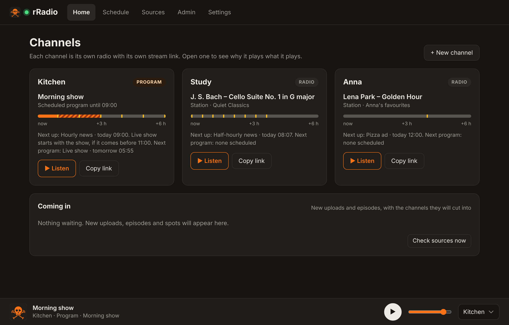

<p align="center"></p>

<h1 align="center">rRadio</h1>

<p align="center">
  <a href="https://github.com/maxASE/rRadio/actions/workflows/ci.yml"></a>
  
  
  <a href="LICENSE"></a>
</p>

<p align="center"><b>A self-hosted internet radio that cuts new episodes, videos and news into the station you already listen to.</b></p>

rRadio plays a normal radio station (or your own music from a Subsonic server
such as Navidrome) and **cuts in automatically** when something you follow
publishes something new: a podcast episode, or a video from a video channel,
played as audio through your own [Invidious](https://invidious.io) instance.
Hourly news, jingles and your own spots cut in on a timer, and other stations
can take over for scheduled shows. Each family member can have their own
channel and stream link.



## Features

- **Several channels**, each with its own Icecast stream (MP3, AAC, Opus) for VLC, Home Assistant, smart speakers or phones.
- **Cut-ins with fades:** new items interrupt the station right away, queue up in order, and the station fades back in afterwards.
- **Scheduled programs**, by clock time or started and ended by the station's own stream title (for live shows without a fixed length).
- **Spots:** hourly news from any podcast feed, jingles and own ads by time, interval or song count.
- **Explains itself:** every channel page says *why* it plays what it plays, and keeps a history you can listen back to.
- **Users and devices:** per-person channels and sources, device keys with QR pairing, a JSON API with tests, and a live event feed for the companion apps.
- **Light on the home server:** three small containers, downloads kept on a RAM disk, about 120 MB of RAM in total.

## How it works

```
 radio station / music server ─┐
 scheduled show               ─┤                          ┌─► /radio.mp3   (channel 1)
 new videos                   ─┼─► Liquidsoap ─► Icecast ─┼─► /anna.mp3    (channel 2)
 podcast episodes             ─┤   (one mix per           └─► /….aac, /….opus ─► VLC, Home Assistant,
 news, jingles, own spots     ─┘    channel)                                     phones, speakers…
                                        ▲
                                        │ HTTP
                                   controller  ◄── web UI and JSON API :8080
             (polls Invidious and RSS, fetches from the music server, downloads audio, schedules)
```

| Part | Built with |
|---|---|
| Controller: scheduling, sources, web UI, API | Python 3.13, FastAPI, httpx, Pydantic, SQLite |
| Audio engine: mixing, fades, encoding | Liquidsoap 2.4 |
| Streaming | Icecast 2.4 |
| Web UI | Plain HTML, CSS and JavaScript, no build step |
| Deployment | Docker Compose, images for amd64 and arm64 |
| CI | GitHub Actions on a self-hosted runner: Liquidsoap script check, 85 API tests, Compose check, image build |

## Quick start

You need Docker with Compose and a running Invidious instance.

```sh
git clone https://github.com/maxASE/rRadio.git
cd rRadio
cp .env.example .env
nano .env          # set the two Icecast passwords and INVIDIOUS_URL
docker compose up -d
```

Open `http://<server>:8080`, add a radio station, video channels and podcasts
under **Sources**, and listen at `http://<server>:8000/radio.mp3` (open a channel
on **Home** for the links plus `.m3u`/`.pls` files).

The web UI has five parts:

- **Home:** a card per channel with what is on, the next six hours and a Listen button.
- **Schedule:** the week as a timeline per channel, with its programs and spots.
- **Sources:** stations, music server playlists, video channels, podcasts and your own media, with a checkbox per channel.
- **Admin:** health, RAM disk, listeners, devices and streams.
- **Settings:** Invidious, your music server, stream formats and the rest.

## Documentation

The [guide](docs/guide.md) covers everything else: how rRadio decides what
plays, connecting Invidious, programs started by the stream title, spots,
stream formats, nginx and Tailscale, users, HTTPS and client certificates,
voice messages, apps and device keys, the dashboard widget, backups, upgrading
and troubleshooting. The API is documented at `http://<server>:8080/api/docs`.

## Development

```sh
cd controller
pip install -r requirements.txt pytest
python -m pytest
```

The tests start the real FastAPI app against a temporary config and database,
with Liquidsoap and the network replaced by fakes.

## License

[MIT](LICENSE)
